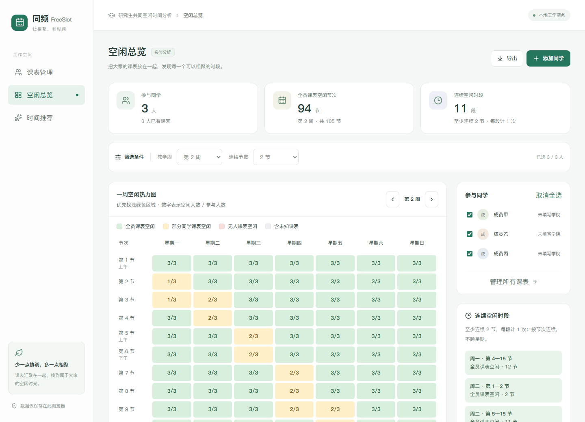

# 什么时候开组会 When is the group meeting? 

**[打开 什么时候开组会WGM 在线版](https://kelo17.github.io/freeslot/)**，用浏览器即可使用。

WGM 帮研究小组从每个人的课表里找出能一起开会的时段。选定成员、教学周和需要的连续节数，就能看到哪些时间每周都可用，以及某位同学在哪一周有课程冲突。

在线版的课表保存在每个人自己的浏览器里。排全组的会时，由一位同学在同一浏览器中导入大家的课表，再把推荐时间或空闲图发到群里。



## 在本机运行

安装 Node.js 22.18 或更高版本。在项目目录运行以下命令。Windows 用户也可以双击 `打开网页.cmd`。

```sh
npm ci
npm run dev -- --host 127.0.0.1 --port 5173 --strictPort
```

浏览器打开 <http://127.0.0.1:5173>。课表保存在当前浏览器的本地存储里。要继续使用以前录入的课表，请使用原来的浏览器配置、网址和端口。清理站点数据会删除已保存的课表。

## 试排一次组会

1. 在「课表管理」点「添加同学」，填写一个代号，例如“小组 A”。点击「载入课表示例」，检查预览后保存。也可以粘贴教务系统复制的表格，或导入 Markdown、制表符分隔的文本文件。
2. 再添加一名同学，粘贴下面的课表并保存。回到「空闲总览」，勾选两人，切到第 2 周。点击周一第 2 节，可以看到谁有课、谁空闲。
3. 在「时间推荐」勾选要开会的教学周和连续节数。优先显示同一组人能在所有选定周参加的时段。展开结果可查看逐周冲突，并复制会议时间。

```markdown
| 课程名称 | 课程代码 | 星期 | 节次 | 上课周次 | 教师 | 地点 |
| --- | --- | --- | --- | --- | --- | --- |
| 纸样制作 | MOCK101 | 星期二 | 3-4 | 1-8周单周 | 教员甲 | 教室A |
| 色彩记录 | MOCK102 | 星期四 | 7-8 | 2,4,6周 | 教员乙 | 教室B |
```

[示例目录](examples/) 提供同一张虚构课表的 Markdown 和制表符版本，可用来对照自己的输入格式。支持第 1–30 教学周、周一至周日、每天第 1–15 节。只添加了姓名的同学会标为课表未知。

## 导出与分享

「导出」支持 PDF、PNG、JPG 和 XLSX，可选择本周、自定义周段或全部。图片适合发到群里，Excel 提供每周空闲图、连续两节可约时间和课表明细。导出覆盖全部已保存的同学，分享前请留意姓名及课程明细。

选择「全部」时，首次出现课程后，遇到首个全员整周无课的周即结束导出。要包含中途的无课周或其后的教学周，可直接指定起止周。课表空闲只表示该时段没有已知课程。

## 构建与贡献

```sh
npm run lint
npm test
npm run build
npm run preview
```

构建生成的 `dist/` 可部署到静态网站根目录或子目录。应用在浏览器中解析课表、计算推荐并生成导出文件。源码使用 React、TypeScript 和 Vite。

欢迎用 Issue 提交建议，或用 Pull Request 提交修改。报告解析问题时，请附最小的**虚构课表**、预期结果和实际结果。解析、空闲计算、时间推荐和导出的测试在 [tests/](tests/)。

项目采用 [MIT 许可证](LICENSE)。构建产物中的第三方许可见 `THIRD-PARTY-LICENSES.md`。
